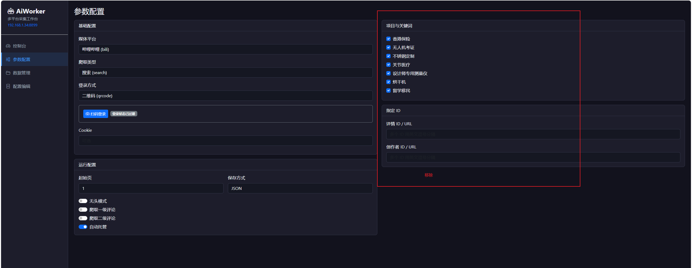
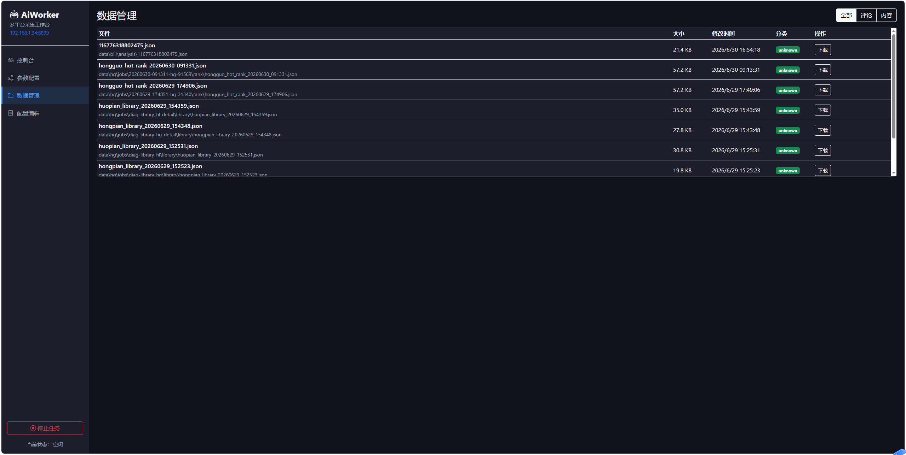
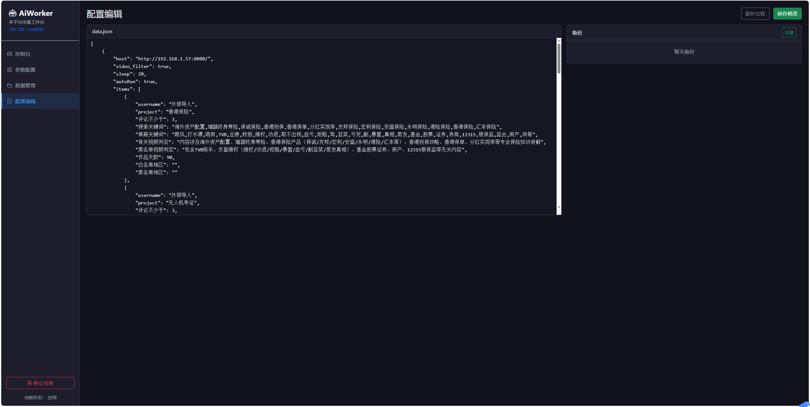

1. 移除项目与关键词、指定ID

2. 数据管理应囊括展示爬取的所有数据文件，json、md、wav、MP4等
    2.1 对于音频新增分析按钮及功能（支持语音转文字，并生成音频摘要）

3. 重构配置编辑页面：
    3.1 移除直接编辑配置文件的方式，改为填写配置表单，参数不变，并且支持加载“data.json”配置文件（格式不变）。
    3.2 表单填写方式是支持添加项目的如：当点击“项目添加”按钮，后新增一栏表单包括：project、评论不少于、搜索关键词、屏蔽关键词、有关视频判定、黑名单视频判定、作品天数、白名单地区、黑名单地区等项
    3.3 表单项需要灵活配置，如参数配置已经设置爬取类型为搜索，则搜索关键词必填，如果是榜单，则不需要配置项目。