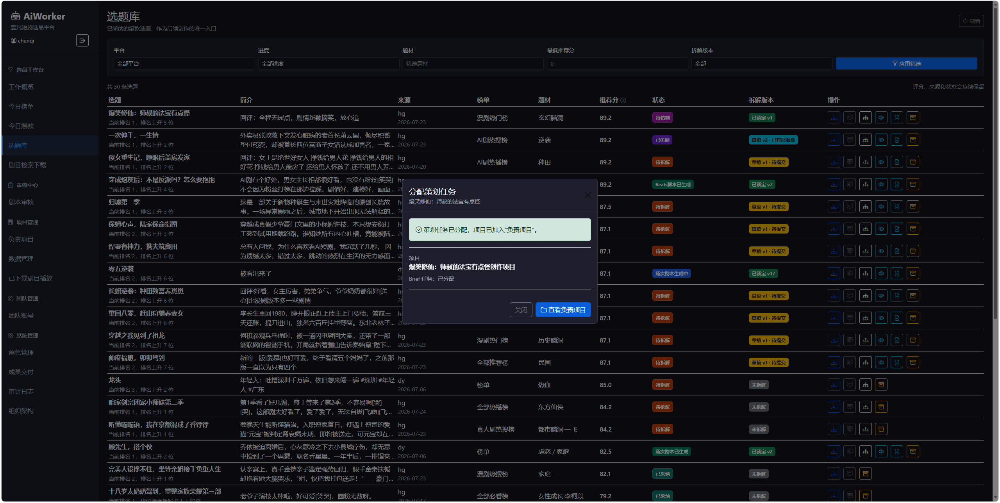
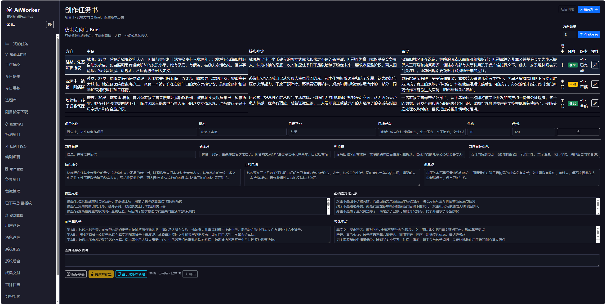
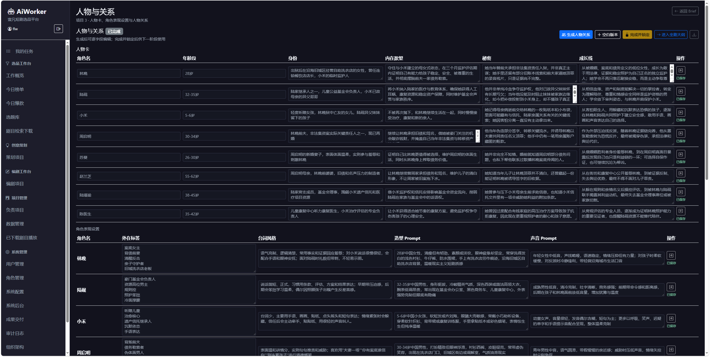
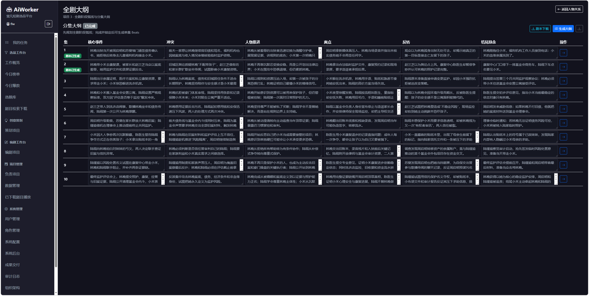
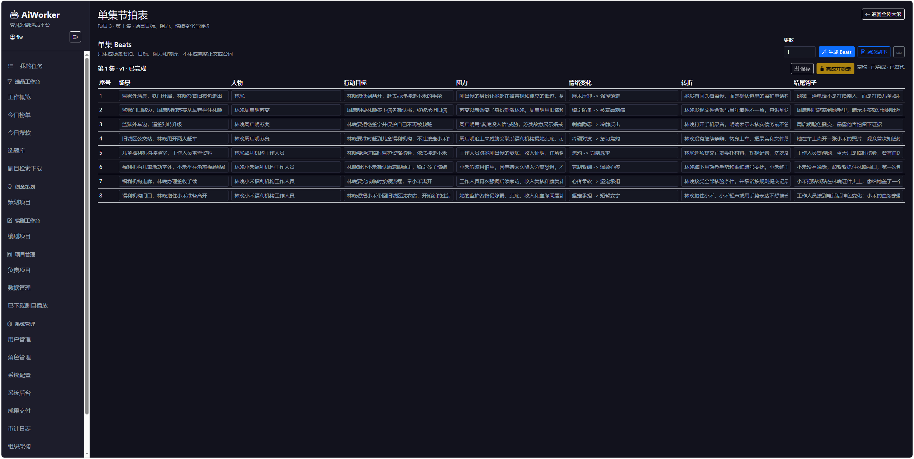
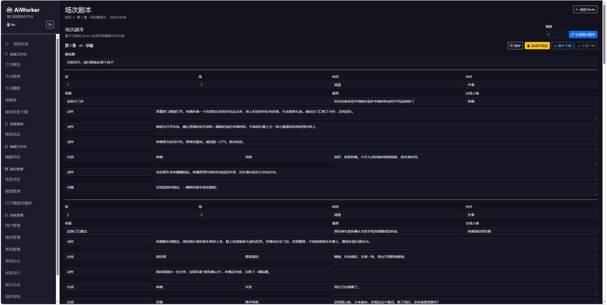

剧本生成流程：

仿写：已拆解剧目 -> 立项 -> 仿写方向 -> Brief

原创：一句话灵感 -> 可选市场参考 -> 3-5 个原创方向 -> Brief

汇合：Brief -> 人物关系 -> 分集大纲 -> Beats -> 场次剧本

策划和编剧都可以从各自的项目页创建原创项目。原创入口中的市场参考只用于提取受众、情绪曲线和制作难度等市场信号，不是改编来源；选定原创方向并锁定 Brief 后，与仿写项目共用后续创作流程。

