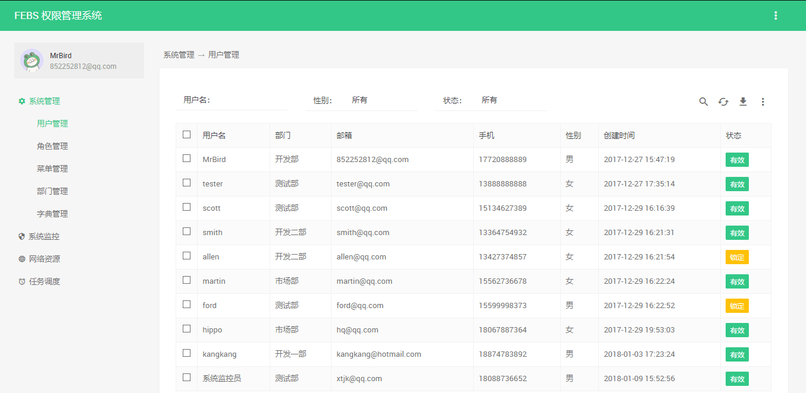

1. 用户管理页面

用户对象需要包含：用户名（已有）、部门归属（已有）、邮箱、手机号、性别、创建时间（已有）、状态（已有）、角色（已有）
需要支持按角色、按部门、按性别、按状态筛选
需要支持按用户名检索，并且可以导出人员表（csv/excel）

4. 新增个人信息页（登录之后的系统默认页）
需要支持查看用户名（已有）、部门归属（已有）、邮箱、手机号、性别、创建时间（已有）、状态（已有）、角色（已有）
支持邮箱、手机号、性别的编辑与修改

<!-- 暂不开发 2. 角色管理

3. 菜单管理（即导航配置）
按照 docs\superpowers\specs\2026-07-28-account-navigation-access-design.md 进行修改 -->